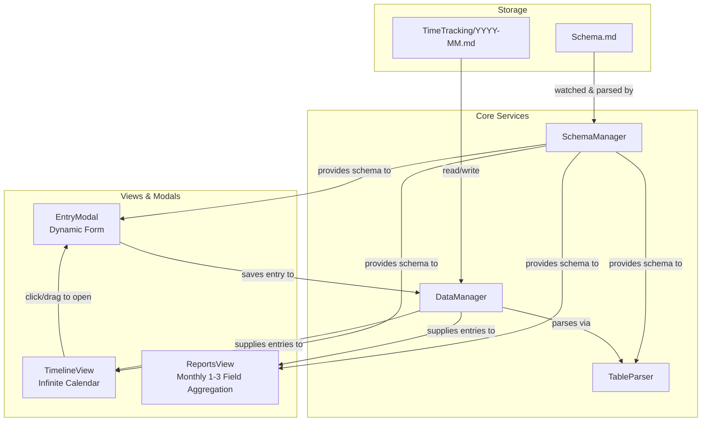
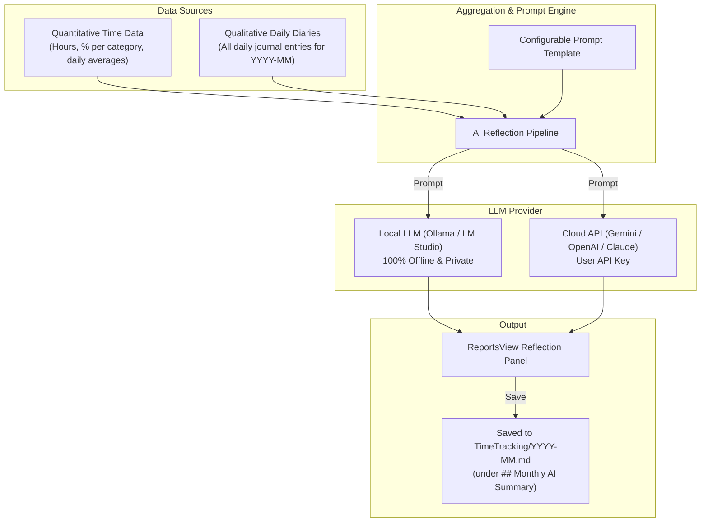
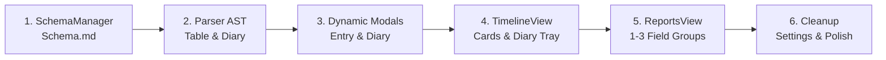

# Personal Time Tracking Plugin: Design Document

This document outlines the design for transforming **Where Did The Time Go?** into a **Personal Time Tracking Obsidian Plugin with Monthly Reporting**. It details the configurable activity entity schema, Markdown persistence, interactive timeline preservation, dynamic entry creation/editing, and configurable multi-level monthly reporting.

---

## 1. Vision & Core Requirements

### 1.1. Motivation
The original plugin was built around freelance client billing (clients, hourly rates, currencies, invoice generation). For personal time tracking and life-logging, users require:
- Complete freedom to define what attributes to track (e.g., Category, Activity Name, Project, Location, Energy Level, Focus, Notes).
- A schema configured natively within Obsidian in a Markdown table file (`Schema.md`).
- The ability to aggregate and visualize time spent each month grouped by 1 to 3 configurable fields (e.g. `Category → Activity Name → Location`).
- Full retention of the visual infinite calendar timeline, interactive click/drag to log time, and plain Markdown table storage in vault files.

### 1.2. Key Requirements
1. **Configurable Schema**:
   - Schema defined inside Obsidian in a clean Markdown table file (`Schema.md`).
   - Fields support types: `string` (free text) or `enum` (predefined options).
   - Fields support constraints: `required` vs `optional`.
   - Fields support cardinality: `single` value vs `multiple` values (arrays / multi-select).
2. **Persistence Integrity**:
   - Reuse the existing monthly Markdown table format (`<timeTrackingFolder>/YYYY-MM.md`).
   - Dynamically map configured fields to Markdown table columns.
   - Support wikilinks (`[[Note Name]]`) and multiline text.
3. **Daily Free-Text Diary**:
   - Ability to write a free-text / Markdown daily reflection or diary entry for any day.
   - Stored directly alongside the activities in the monthly markdown file (`TimeTracking/YYYY-MM.md`).
   - Visual presence on the calendar timeline (e.g. pinned header pill / all-day tray) with quick preview and popover editing.
4. **Timeline & Calendar Experience**:
   - Retain 24-hour visual grid, infinite scroll, 15-minute snapping.
   - Click/drag on timeline to open entry form with pre-filled time interval.
   - Drag-to-move, drag-to-resize, adjacent magnetic snapping, and conflict detection.
   - Render cards dynamically using configured field values (e.g., color from category, title from activity name, badges from secondary fields).
5. **Monthly Reporting**:
   - Monthly focus: report on any calendar month with monthly KPIs and breakdown.
   - Configurable aggregation: group time spent by 1, 2, or 3 chosen fields in a nested hierarchy.
   - Dynamic drilldown, duration subtotals, and percentage breakdowns.
   - CSV and JSON export.
   - *(Phase 2 / Future Scope)*: AI-powered monthly reflection combining quantitative time metrics with daily diaries.
6. **Decouple Invoicing**:
   - Remove or deprecate commercial billing abstractions (hourly rates, currencies, invoice templates, clients table) to simplify the UX.

---

## 2. Field Configuration System (`Schema.md`)

### 2.1. File Location & Loading
The configuration file is stored inside the vault as an Obsidian-native Markdown file:
```
<vault>/<timeTrackingFolder>/Schema.md
```
- **Obsidian Native Table**: Users can view and edit `Schema.md` directly inside Obsidian with Obsidian's interactive table editor.
- **Deterministic Color Hashing**: Enum options are assigned consistent hex colors deterministically hashed from string values (`hash(value) % palette.length`), so users don't have to fiddle with manual hex codes.
- **Reactive Reload**: A vault file watcher listens for modifications to `Schema.md` and hot-reloads the schema in memory without requiring a plugin restart.
- **Default Fallback**: If `Schema.md` does not exist, the plugin generates a default template file on startup.

### 2.2. Schema Specification

```typescript
export type FieldType = 'string' | 'enum';

export interface EnumOption {
    /** Unique value slug */
    id: string;
    /** Human-readable label displayed in UI */
    label: string;
    /** Deterministically hashed color code */
    color?: string;
    /** Historical names */
    aliases?: string[];
}

export interface FieldDefinition {
    /** Unique identifier matching the Markdown column or key */
    id: string;
    /** Display label shown in modals and report headers */
    label: string;
    /** Data type */
    type: FieldType;
    /** Whether the field must be non-empty to save an entry */
    required: boolean;
    /** Whether the field holds a single value or an array of values */
    multiple: boolean;
    /** Historical names used in older markdown table headers */
    aliases?: string[];
    /** Allowed options for 'enum' fields */
    options?: EnumOption[];
    /** Default value for new entries */
    defaultValue?: string | string[];
    /** UI presentation hints */
    ui?: {
        widget?: 'text' | 'textarea' | 'dropdown' | 'tags' | 'note-link';
        placeholder?: string;
        /** Role on timeline card: 'title' | 'color' | 'badge' | 'hidden' */
        timelineRole?: 'title' | 'color' | 'badge' | 'hidden';
    };
}

export interface TrackingSchemaConfig {
    version: number;
    /** Ordered list of fields */
    fields: FieldDefinition[];
    /** Default report aggregation hierarchy (1 to 3 field IDs) */
    defaultReportGrouping: string[];
}
```

### 2.3. Example Configuration (`Schema.md`)

```markdown
# Activity Tracking Schema

Edit the table below to customize your activity fields.
Changes are saved and applied automatically.

| Field Name | Type | Required | Options | Allow Multiple | Timeline Role | Report Dimension | Aliases |
| :--- | :--- | :--- | :--- | :--- | :--- | :--- | :--- |
| Category | enum | Yes | Deep Work, Shallow Work, Fitness, Learning, Personal, Leisure, Work | No | Color | 1 | activity |
| Activity Name | string | Yes | | No | Title | 2 | task, description |
| Location | enum | No | Home Office, Office, Coffee Shop, Gym, Transit, Movement | No | Badge | 3 | place |
| Tags | string | No | | Yes | Badge | | tags |
| Notes | string | No | | No | Hidden | | linked note |

> [!TIP]
> - **Type**: \`enum\` or \`string\`.
> - **Options**: Comma-separated values for \`enum\` fields. Colors are assigned automatically and stay consistent.
> - **Timeline Role**: \`Color\` (drives card background/border), \`Title\` (card heading), \`Badge\` (pill badge), or \`Hidden\`.
> - **Report Dimension**: \`1\`, \`2\`, or \`3\` defines the aggregation hierarchy in monthly reports.
> - **Aliases**: Comma-separated historical column names so older monthly records parse without data loss.
```

---

## 3. Data Model & Storage

### 3.1. Entity Model

The `TimeEntry` interface is generalized so that non-temporal attributes reside in a dynamic `fields` dictionary:

```typescript
export interface TimeEntry {
    /** Primary date: YYYY-MM-DD */
    date: string;
    /** Start time in HH:mm */
    start: string;
    /** End time in HH:mm (or next day) */
    end: string;
    /** Computed start Date */
    startDateTime: Date;
    /** Computed end Date */
    endDateTime: Date;
    /** Duration in minutes */
    durationMinutes: number;
    /** Row index in monthly table */
    lineNumber: number;

    /**
     * Dynamic values for configured fields.
     * Single fields store string; multiple fields store string[].
     */
    fields: Record<string, string | string[]>;
}

/**
 * Free-text daily reflection or journal entry
 */
export interface DailyDiary {
    /** Target date: YYYY-MM-DD */
    date: string;
    /** Markdown / free-text content */
    content: string;
    /** Optional last modified timestamp */
    updatedAt?: string;
}

/**
 * Complete parsed representation of a monthly file
 */
export interface MonthlyData {
    month: string; // YYYY-MM
    entries: TimeEntry[];
    entriesByDate: Map<string, TimeEntry[]>;
    diariesByDate: Map<string, DailyDiary>;
    aiSummary?: string;
}
```

### 3.2. Markdown File Layout (Co-locating Activities, Diaries & AI Summary)

Storage remains unified in monthly files at `<timeTrackingFolder>/YYYY-MM.md`. Storing activities, daily diaries, and AI summaries in a single monthly file maintains vault cleanliness (12 files per year) while keeping all data for a month co-located and human-readable.

#### File Structure Specification:
```markdown
%%
⚠️ WARNING: This file is managed by the Personal Time Tracking plugin.
Do not edit manually - your changes may be overwritten.
%%

# 2026-10

%%
| Start            | End              | Category  | Activity Name          | Location    | Tags             | Notes              |
| :--------------- | :--------------- | :-------- | :--------------------- | :---------- | :--------------- | :----------------- |
| 2026-10-15 08:30 | 2026-10-15 10:00 | deep-work | System design for time | home        | coding, planning | [[ArchitectureDoc]]|
| 2026-10-15 10:15 | 2026-10-15 11:15 | fitness   | Morning 5k run         | outdoor     | cardio           |                    |
| 2026-10-15 11:30 | 2026-10-15 12:30 | learning  | Read papers on agentic | cafe        | ai, reading      | [[AgentResearch]]  |
%%

## Daily Diaries

### 2026-10-15
High mental clarity this morning. Finished the AST parser and schema specifications before lunch. 
Afternoon felt sluggish after heavy meal; took a 20-minute walk which helped reset focus. 
Tomorrow: tackle dynamic modal components.

### 2026-10-16
Focused on UI integration for the timeline view. Good flow throughout the day.

## Monthly AI Summary
> Generated on 2026-10-31 21:00

### Key Highlights
- Logged **142 total hours** across 22 active days (average 6.4h / day).
- **Deep Work** accounted for **54%** of tracked time, peaking between 08:30 and 12:00.

### Habit & Energy Insights
- Morning workouts (3x/week) correlated with 25% higher logged focus durations in the afternoons.
- Noted afternoon slumps on days with sedentary lunch breaks; walking breaks resolved fatigue effectively.
```

#### AST Parsing & Safe Serialization:
The unified/remark processor parses the document tree into distinct node types:
1. **Table Node**: Contains all chronological time entry rows.
2. **Heading `## Daily Diaries`**: Followed by `### YYYY-MM-DD` subsections, parsed into `DailyDiary` objects.
3. **Heading `## Monthly AI Summary`**: Contains the generated reflection markdown.
When saving activities or updating diaries, `TableParser` updates only the corresponding AST subtree and serializes the complete document back to disk, guaranteeing that editing activities never damages diaries or summaries.

### 3.3. Backwards Compatibility & Table Parsing
The refactored `TableParser` will:
- Read table headers dynamically from row 0 of each individual file.
- Match columns to the active schema by case-insensitive matching on `field.id`, `field.label`, and optional `field.aliases`.
- Preserve any unexpected or legacy columns (e.g. `Client`, `Project` from previous files) in a `rawFields` map so that editing an entry does not destroy unrecognized data.

### 3.4. Schema Evolution & Forward Compatibility Guarantees

As personal tracking needs evolve over months and years, fields and properties in `Schema.md` will inevitably change. The table below details how the engine handles each schema mutation and what guarantees are enforced:

| Mutation | What Happens to Historical Data? | Engine Behavior & Guarantee |
| :--- | :--- | :--- |
| **New field added** | Old files lack this column entirely. | **Tolerant Load**: Old entries load with field value as `undefined` (or `field.defaultValue`). Reports treat missing values as `(Not set)` without crashing. |
| **Field renamed** | Header in old files has the old name. | **Header Aliasing**: `FieldDefinition` supports an `aliases: string[]` array. Example: `label: "Domain", aliases: ["Category"]`. Parser matches against `id`, `label`, or any alias. |
| **Field removed** | Old files still contain this column. | **Round-Trip Preservation**: Unrecognized columns are preserved in `entry.unmappedFields`. When an old month file is rewritten, unmapped columns are preserved so historical data is never wiped. |
| **Column order changed** | Old files have columns in different order. | **Order Agnostic**: Columns are mapped by name from row 0, never by hardcoded numerical indices. |
| **Toggled to `required: true`** | Old entries may have empty values. | **Strict on Write, Tolerant on Read**: Required-field validation is enforced *only* when saving via `EntryModal`. It is never enforced on file load. Editing an old entry prompts the user to populate the missing field. |
| **Cardinality changed (`single` ↔ `multiple`)** | Data is scalar or array. | **Automatic Coercion**: If `multiple: true`, `"reading"` becomes `["reading"]`. If `multiple: false`, `["reading", "audio"]` is joined as `"reading, audio"` or picks the first item. |
| **Enum option deleted / renamed** | Old entry has an option no longer in enum list. | **Fallback Display**: The parser retains the raw string. In UI, it is displayed as a neutral fallback tag (e.g., `"(legacy) Option"`) rather than being dropped or triggering an error. |

#### Schema Definition with Aliases Support:
```typescript
export interface FieldDefinition {
    id: string;
    label: string;
    type: FieldType;
    required: boolean;
    multiple: boolean;
    /** Historical names used in older markdown table headers */
    aliases?: string[];
    /** Allowed options for 'enum' fields */
    options?: EnumOption[];
    defaultValue?: string | string[];
    ui?: FieldUIPresentation;
}

export interface EnumOption {
    id: string;
    label: string;
    color?: string;
    /** Historical values used for this option */
    aliases?: string[];
}
```

#### Best Practices for Forward Compatibility (User Checklist):
1. **Prefer stable `id`s**: Change the `label` for display purposes, but keep the `id` stable across schema changes.
2. **Use `aliases` when renaming**: If changing an existing column header or `id`, add the old name to the `Aliases` column in `Schema.md`.
3. **Never mutate old files manually**: Let the plugin handle reading legacy headers gracefully; there is no need to manually rename columns in files from past years.
4. **Provide defaults for new required fields**: If adding a new field that is `required: true`, supply a `defaultValue` so new entries start with a valid value.


---

## 4. UI Architecture & Adaptations



### 4.1. Calendar & Timeline View (`TimelineView`)
The calendar remains the visual center of daily tracking:
- **Interactive Drag-to-Create**: Clicking and dragging vertically on any day creates a temporary highlight showing start/end rounded to 15-minute increments. On release, it opens `EntryModal`.
- **Drag-to-Move & Resize**: Dragging cards shifts time blocks; dragging top/bottom handles adjusts durations. Live red highlight warns of overlaps.
- **Dynamic Card Styling**:
  - **Color**: Uses the option color of whichever field has `timelineRole: 'color'` (typically `category`).
  - **Title**: Displays the value of `timelineRole: 'title'` (typically `activity_name`).
  - **Badges/Tags**: Displays pill tags for fields with `timelineRole: 'badge'` (e.g. `location`, `tags`).
  - **Tooltip**: Hovering over any card displays a neat breakdown of all populated attributes and total duration.

#### Daily Diary Presentation on the Timeline:
- **Sticky Day Header / All-Day Tray**: Above the 00:00 ruler of each day column, a dedicated diary badge/chip is displayed:
  - **When a Diary Exists**: Renders a highlighted `📝 Diary` pill with a truncated preview of the first sentence. Hovering displays a rich tooltip showing the full diary text.
  - **When No Diary Exists**: Renders a subtle `+ Diary` button encouraging daily reflection.
- **One-Click Interaction**: Clicking the badge opens the `DailyDiaryModal` to read or edit the reflection for that day.

### 4.2. Dynamic Entry Modal (`EntryModal`)
The modal dynamically constructs form elements based on `Schema.md`:

1. **Temporal Controls (Standard)**:
   - Start Date & Time input (with HH:mm segmenting and 12h/24h toggle).
   - End Date & Time input.
   - Duration badge/input (e.g., typing "1.5h" adjusts end time).
   - Magnetic snap buttons (🧲) to connect seamlessly to adjacent entries without gaps.
2. **Dynamic Schema-Driven Form Controls**:
   - `enum` + `single`: Rendered as an Obsidian `DropdownComponent`.
   - `enum` + `multiple`: Rendered as an interactive multi-select tag picker or checkbox cluster.
   - `string` + `single`: Rendered as `TextComponent` (or multiline `TextAreaComponent` if configured).
   - `string` + `multiple`: Rendered as a tag-input component allowing users to add/remove chip values.
   - `widget: "note-link"`: Rendered with an Obsidian `FuzzySuggestModal` note picker button to select files from the vault.
3. **Form Validation**:
   - Validates that `end > start`.
   - Validates that no overlaps exist (unless explicitly permitted).
   - Validates all fields marked with `required: true` contain at least one non-empty value.

### 4.3. Daily Diary Modal (`DailyDiaryModal`)
A streamlined modal for journaling alongside logged time:
- **Context Header**: Displays the selected date and a quick snapshot of the activities logged on that day (e.g., *"3 entries logged • 5h 30m total: 3.5h Deep Work, 1h Fitness, 1h Admin"*). This gives the user immediate context on what they did while reflecting.
- **Markdown Editor Area**: Full multiline Markdown text area supporting paragraphs, bullet points, checklists, and Obsidian `[[wikilinks]]`.
- **Keyboard Shortcuts**: `Cmd/Ctrl + Enter` to save and close; `Esc` to cancel.
- **Reactive Update**: Saving immediately updates the timeline header badge and rewrites the `## Daily Diaries` section of the month file.

---

## 5. Configurable Monthly Reporting Engine (`ReportsView`)

### 5.1. Overview & Monthly Focus
Unlike client billing reports that prioritize invoicing, the personal monthly report focuses on **time allocation, habits, and self-reflection**.

Key elements:
- **Month Picker**: Dedicated navigation (`< Prev Month | 2026-10 | Next Month >`), plus presets (This Month, Last Month, Custom Date Range).
- **Monthly Summary Cards**:
  - Total time tracked (e.g., `142h 30m`).
  - Daily average (e.g., `4h 45m / day`).
  - Top category/activity by hours and percentage.
  - Active tracking days in the month.

### 5.2. Configurable 1 to 3 Field Aggregation Engine
Users can select **1, 2, or 3 fields** to group by from the active schema.

#### Examples:
- **1-Level Grouping**: `Category`
  - See high-level distribution: Deep Work (40%), Exercise (15%), Learning (15%), etc.
- **2-Level Grouping**: `Category → Activity Name`
  - Deep Work
    - Write Obsidian Plugin (25h)
    - Code Refactoring (15h)
  - Exercise
    - Morning Run (10h)
    - Gym Strength (8h)
- **3-Level Grouping**: `Category → Activity Name → Location`
  - Deep Work
    - Write Obsidian Plugin
      - Home Office (18h)
      - Coffee Shop (7h)

#### UI Controls in Reports View:
- Three dropdown selectors at the top of the report:
  - **Group By Level 1**: [ Category ▾ ] *(Required)*
  - **Group By Level 2**: [ Activity Name ▾ ] *(Optional / None)*
  - **Group By Level 3**: [ Location ▾ ] *(Optional / None)*
- Saved as user preferences so the layout persists across sessions.

### 5.3. Multi-Value Field Aggregation Strategy
When grouping by a field with `multiple: true` (e.g., `tags: ["coding", "oss"]`):
- **Strategy Option A (Composite grouping - Recommended for primary level)**: Treats the combination `coding, oss` as a distinct group, avoiding double-counting total hours.
- **Strategy Option B (Unnested multi-tag breakdown)**: In a secondary tag breakdown section, each tag shows its associated total hours independently, with a clear note that tag sums may exceed total tracked time.

### 5.4. Tree Table & Visualizations
The report displays a nested tree table:
- Rows are expandable/collapsible (`▶` / `▼`).
- Columns:
  1. **Group Hierarchy** (Level 1 / 2 / 3 labels with color dots).
  2. **Total Duration** (`XXh YYm`).
  3. **% of Parent** (percentage of time within the enclosing group).
  4. **% of Total** (percentage of overall monthly tracked time).
  5. **Visual Progress Bar** (colored according to the group's enum color).
- Export actions: **Export CSV** and **Export JSON** reflecting the active grouping.

### 5.5. [Phase 2 — Future / Unplanned] Monthly AI Reflection & Summarization Engine

> [!NOTE]
> **Status: Phase 2 (Future Scope — Not Planned for Immediate Release)**
> This feature requires external or local LLM integration and is documented here for architectural reference and forward-looking design. The initial implementation (Phase 1) delivers the complete core workflow: configurable schema, multi-section storage, timeline visual tracking, daily diaries, and 1 to 3 field quantitative monthly reports.

The AI Summarization feature bridges the gap between **quantitative time logging** (how many hours spent where) and **qualitative daily reflections** (how you felt, what blocked you, what you achieved).



#### 1. Data Aggregation Pipeline:
When the user clicks **"Generate AI Monthly Reflection"** in the Reports view, the engine prepares a structured context payload containing:
1. **Aggregated Time Metrics**:
   - Total tracked time, active days, daily average.
   - Percentage distribution across categories and top activities.
   - Day-by-day activity distribution (e.g., peak focus days, light days).
2. **Chronological Daily Diaries**:
   - Every daily diary entry recorded during that month formatted chronologically:
     ```markdown
     Date: 2026-10-01
     Diary: Started the sprint with great energy. Finished prototype.
     ---
     Date: 2026-10-05
     Diary: Slept poorly, struggled to focus on refactoring in the afternoon...
     ```

#### 2. Synthesized Reflection Output:
The prompt instructs the AI to generate a structured personal reflection with four sections:
- 🎯 **Key Accomplishments & Themes**: Highlights derived from major logged projects and positive journal milestones.
- ⚡ **Energy & Habit Correlations**: Observations linking time allocation to subjective well-being (e.g. *"On days where exercise was logged before 09:00, deep work sessions averaged 3.2 hours with positive diary notes"*).
- 🚧 **Friction & Patterns**: Identification of recurring blockers, fatigue triggers, or days where planned activities were diverted.
- 💡 **Actionable Focus for Next Month**: 2-3 concrete, realistic adjustments for the upcoming month.

#### 3. Privacy-First Provider Architecture:
Users can select their preferred AI provider in Settings:
- **Local LLM via Ollama / LM Studio (Recommended for vault privacy)**:
  - Connects to local endpoint (e.g., `http://127.0.0.1:11434/api/generate` or OpenAI-compatible local server).
  - No personal diary text or time logs ever leave the local machine.
- **Cloud LLM API**:
  - Direct calls to Google Gemini, OpenAI, or Anthropic using the user's private API key.
- **Obsidian Copilot / Smart Connections Integration**:
  - Optional fallback to dispatch the prompt to existing community AI plugins installed in the vault.

#### 4. Persistence & Review:
- **Save to Monthly File**: Clicking "Save to Month File" writes the reflection directly under the `## Monthly AI Summary` heading in `TimeTracking/YYYY-MM.md`.
- **Cached Display**: When opening ReportsView for a past month, previously generated AI summaries are loaded from the file instantly without re-calling the LLM.

---

## 6. Migration & Deprecation Strategy

### 6.1. Retiring Billing Modules
The following billing-only code will be cleanly phased out:
- `src/invoice/InvoiceGenerator.ts`
- `src/modals/InvoiceModal.ts`
- `src/modals/ClientModal.ts`
- `Client`, `BillFrom`, and billing rate settings in `types.ts` and `settings.ts`.

### 6.2. Upgrading Existing Vault Data
For vaults with existing `TimeTracking/YYYY-MM.md` files:
1. Default `Schema.md` defines `category` (mapped from old `activity`), `activity_name` (mapped from old `project` or `description`), and `notes` (mapped from old `notes`).
2. When `TableParser` reads existing files with columns `| Start | End | Description | Client | Project | Activity | Notes |`, it gracefully maps:
   - `Start` → `Start`
   - `End` → `End`
   - `Activity` → `Category`
   - `Project` or `Description` → `Activity Name`
   - `Notes` → `Notes`
3. No data is lost; unmapped columns are preserved during edits.

---

## 7. Implementation Roadmap

### Phase 1: Core Personal Time Tracking & Daily Diary (Immediate Scope)

Implementation is split into discrete, self-contained, submittable steps. Each step includes unit tests, documentation sync, and human verification in the test vault (`vaults/personal-time-tracking-vault/`).



#### Step 1: Schema Manager & Configuration Service (`Schema.md`)
- **Code Changes**: Implement `SchemaManager` service to read, validate, cache, and watch `<timeTrackingFolder>/Schema.md`. Provide automatic default generation with Obsidian Markdown table and tips. Implement deterministic color hashing for enum options. Update `src/types.ts` with `FieldDefinition`, `DailyDiary`, `MonthlyData`, and dynamic `TimeEntry`.
- **Unit Tests**: Add `tests/SchemaManager.test.ts` and `tests/Colors.test.ts` covering Markdown table parsing, color hashing, option parsing, and fault recovery.
- **Docs Sync**: Document `Schema.md` format and options in `docs/DEVELOPMENT.md`.
- **Test Vault Verification**:
  - Open `vaults/personal-time-tracking-vault/`.
  - Confirm `TimeTracking/Schema.md` is generated automatically as an editable Obsidian table.
  - Modify a field label or add an enum option in `Schema.md` in Obsidian; verify the console logs a successful reload.

#### Step 2: Multi-Section Parser & DataManager Refactor
- **Code Changes**: Refactor `TableParser` using unified/remark to parse and serialize both the activities table and the `## Daily Diaries` section. Refactor `DataManager` to store dynamic entry fields and add diary CRUD operations (`getDiary`, `saveDiary`).
- **Unit Tests**: Update `tests/TableParser.test.ts` and add tests for dynamic table columns, unrecognized column round-tripping, and diary section parsing.
- **Docs Sync**: Document the multi-section Markdown layout in `docs/DEVELOPMENT.md`.
- **Test Vault Verification**:
  - Check existing file `TimeTracking/2025-12.md`.
  - Trigger a save; verify that existing table columns are preserved and diary sections are cleanly created.

#### Step 3: Dynamic Entry Form & Daily Diary Modal
- **Code Changes**: Update `EntryModal` to dynamically construct UI inputs based on `Schema.md` (`dropdown`, `text`, `tags`, `note-link`). Implement `DailyDiaryModal` with a Markdown editor and daily activity snapshot summary.
- **Unit Tests**: Add `tests/EntryModal.test.ts` and `tests/DailyDiaryModal.test.ts` verifying input generation, required-field validation, and diary submission.
- **Docs Sync**: Update modal field documentation in `docs/`.
- **Test Vault Verification**:
  - In Obsidian, press `Ctrl/Cmd + P` → "Create time entry".
  - Verify that modal controls reflect the fields in `Schema.md`.
  - Try saving without a required field; verify validation error.
  - Open `DailyDiaryModal`, write a test note, and verify it writes to `## Daily Diaries` in the current month file.

#### Step 4: Timeline View Adaptation & Day Header Diary Tray
- **Code Changes**: Update `TimelineView` day column headers with a sticky diary pill (`📝 Diary` with tooltip or `+ Diary`). Adapt entry cards to use the designated enum color, primary string title, and secondary badge pills.
- **Unit Tests**: Component rendering and badge logic unit tests.
- **Docs Sync**: Update timeline view usage documentation in `README.md`.
- **Test Vault Verification**:
  - Open Timeline view.
  - Observe the diary indicator in each day's header. Click to open and edit diary.
  - Click and drag on the timeline to create a new activity; verify card displays the chosen category color and badges.

#### Step 5: Configurable 1 to 3 Field Monthly Reports View
- **Code Changes**: Overhaul `ReportsView` to focus on calendar months (`< YYYY-MM >`). Implement 3 dropdown selectors (Level 1, Level 2, Level 3). Build the recursive aggregation engine and expandable tree table UI. Update CSV and JSON export.
- **Unit Tests**: Add `tests/ReportsView.test.ts` testing 1-level, 2-level, and 3-level tree aggregation, percentage math, and multi-value handling.
- **Docs Sync**: Update reports view section in `README.md`.
- **Test Vault Verification**:
  - Open Reports view in Obsidian.
  - Switch months using the month picker.
  - Change grouping to `Category → Activity Name → Location`.
  - Expand and collapse tree rows; verify hours, subtotals, and progress bar colors.

#### Step 6: Settings UI, Billing Deprecation & Cleanup
- **Code Changes**: Remove `ClientModal`, `InvoiceModal`, `InvoiceGenerator`, and commercial billing settings. Update `TimeTrackerSettingTab` with schema path, field preview, and default report grouping.
- **Unit Tests**: Full regression test suite (`npm test`). Remove obsolete billing test suites.
- **Docs Sync**: Update `README.md` to completely remove client/invoice references; update `docs/DEVELOPMENT.md`.
- **Test Vault Verification**:
  - Open Obsidian Settings → Where Did The Time Go.
  - Confirm settings tab is clean, free of billing options, and correctly displays tracking options.
  - Confirm zero console errors on startup.

---

### Phase 2: Monthly AI Reflection & Summarization (Future / Not Yet Planned)

*Deferred to a future release once the core tracking engine and daily diaries are established.*

- **LLM Provider Integration**:
  - Local LLM connection via Ollama or LM Studio (`http://127.0.0.1:11434`) for private, offline reflection.
  - Optional Cloud API integration (Google Gemini, OpenAI, Anthropic Claude) via user API key.
- **Context Assembly & Prompt Engine**:
  - Aggregate monthly quantitative statistics (hours, percentages, category distributions).
  - Concatenate all daily diary entries recorded during the month.
  - Synthesize structured accomplishments, energy patterns, blockers, and recommendations.
- **ReportsView Reflection Panel & Persistence**:
  - Add interactive "Generate AI Summary" panel in `ReportsView`.
  - Persist generated reflections directly into `## Monthly AI Summary` in `TimeTracking/YYYY-MM.md`.

---

## 8. Implementation & Verification Principles

To ensure engineering quality, maintain project momentum, and prevent token waste or implementation drift, the following principles must be adhered to throughout development:

### 8.1. Unit Testing Mandate
- Every code change must be covered by automated unit tests (using Jest and `ts-jest`).
- No step is considered complete until all unit tests execute and pass (`npm test` exits with code 0).
- Edge cases (such as midnight-spanning entries, missing columns, malformed JSON, and empty files) must have dedicated test coverage.

### 8.2. Continuous Code & Documentation Synchronization
- Code and documentation must never diverge.
- When an architecture change occurs (e.g., removing commercial invoicing or modifying the file structure), the relevant documentation (`README.md`, `DEVELOPMENT.md`, `docs/`) must be updated in that exact same step.
- Dead documentation, outdated screenshots, or obsolete instructions must be pruned immediately.

### 8.3. Incremental, Submittable Slices
- Work must proceed in small, discrete steps as defined in the Roadmap.
- Each step must represent a coherent, working slice that is ready for a clean Git commit.
- Never leave the codebase in a broken or non-compiling intermediate state between turns.
- Limiting each turn to one step prevents excessive token consumption and enables focused human review.

### 8.4. Human Notification & Verification Protocol
At the conclusion of each implementation step, the developer/assistant must:
1. Provide a concise summary of all files created, modified, or deleted.
2. Confirm that `npm test` passed with test output metrics.
3. List any synchronized documentation updates.
4. Provide a clear, bulleted **"What to verify in the test vault"** checklist, detailing exact UI actions, file changes, and behaviors for the human to test in Obsidian.


