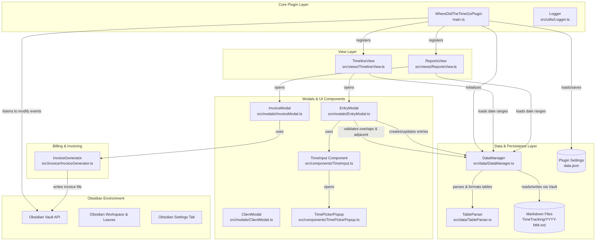
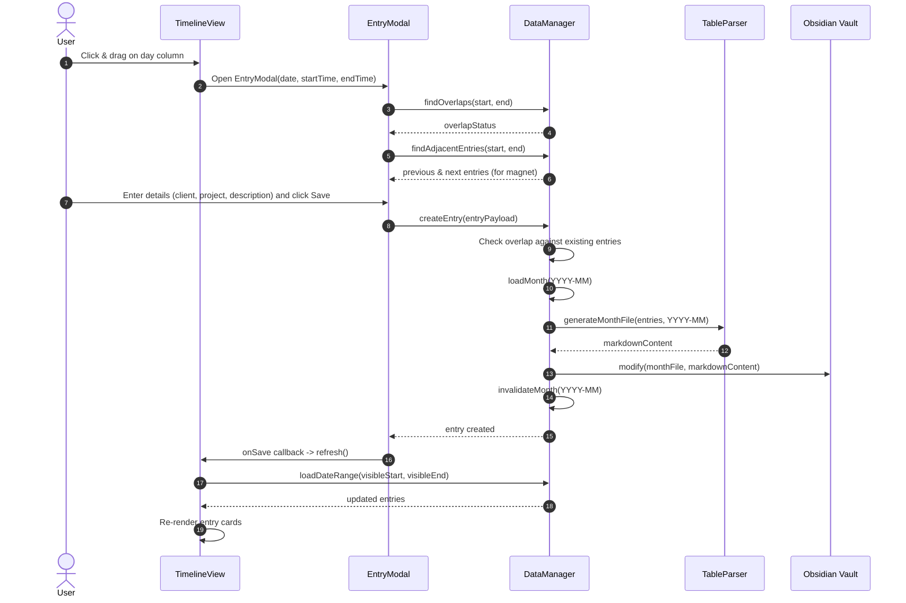
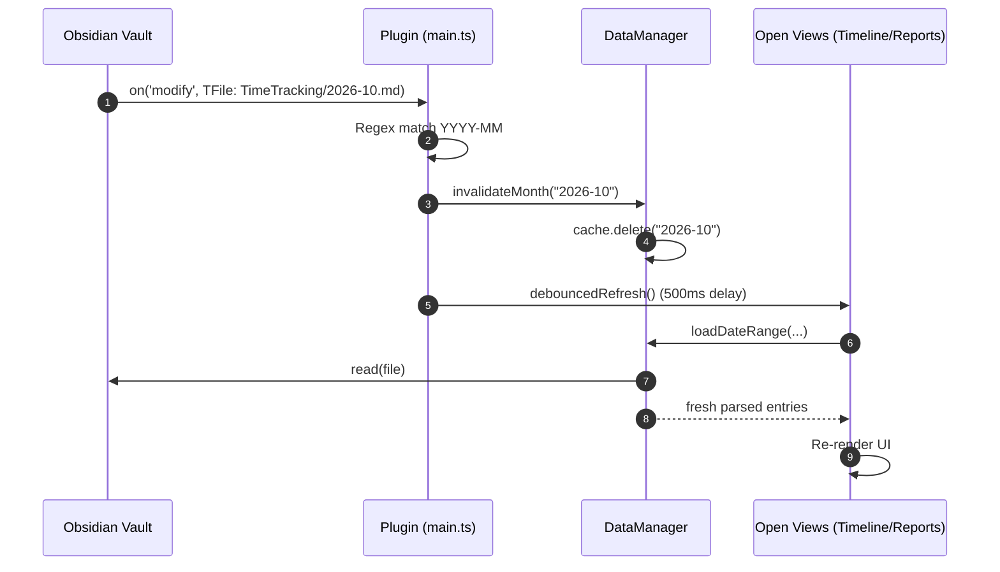

# Original Architecture of "Where Did The Time Go?"

This document provides a comprehensive overview of the existing/original codebase for **Where Did The Time Go?** (forked from `https://github.com/plattnum/where-did-the-time-go`). It explains the architectural layers, module responsibilities, runtime data flows, storage model, and component interactions prior to personal tracking refactoring.

---

## 1. System Overview & Principles

"Where Did The Time Go?" is an Obsidian desktop plugin designed for offline, local-first visual time tracking. The architecture is centered around three primary principles:

1. **Vault-Native Markdown Storage**: All time entries are persisted directly in human-readable Markdown tables inside vault files (`<timeTrackingFolder>/YYYY-MM.md`). No external databases, binary stores, or cloud sync services are required.
2. **Infinite Scroll Visual Timeline**: The primary interface is a bi-directional infinite timeline displaying a continuous 24-hour vertical ruler with drag-and-drop entry creation, resizing, and repositioning.
3. **Hierarchical Reporting & Billing**: A reporting engine aggregates time entries across multiple dimensions, with billable hours calculation and markdown invoice generation.

---

## 2. High-Level Component Architecture



---

## 3. Directory & Module Breakdown

| Directory / File | Core Responsibility |
| :--- | :--- |
| `main.ts` | Plugin entry point; registers views, commands, ribbon icons, and vault file modify listeners. |
| `src/types.ts` | Core TypeScript interfaces (`TimeEntry`, `TimeTrackerSettings`, `Client`, `Project`, `Activity`, `ParsedMonth`, report types). |
| `src/settings.ts` | Settings UI tab for configuring storage path, timeline display limits, 12/24h formats, clients, projects, and activities. |
| `src/data/DataManager.ts` | Data broker managing CRUD operations, LRU month caching (up to 24 months), overlap validation, midnight duration clamping, and file access. |
| `src/data/TableParser.ts` | Markdown AST parser/serializer using `unified`, `remark-parse`, `remark-gfm`, and `remark-stringify` for GFM markdown tables. |
| `src/views/TimelineView.ts` | Obsidian `ItemView` rendering the infinite scrolling 24-hour timeline, day columns, entry cards, drag handles, and drag-to-create. |
| `src/views/ReportsView.ts` | Obsidian `ItemView` providing time range filtering, hierarchical aggregation (Client → Project → Activity), and CSV/JSON export. |
| `src/modals/EntryModal.ts` | Modal for creating and editing time entries with conflict warning, adjacent magnet snapping, and linked note selection. |
| `src/modals/ClientModal.ts` | Modal for creating and updating client billing metadata (rates, currency, payment terms). |
| `src/modals/InvoiceModal.ts` | Modal gathering invoice number, due date, and terms for invoice markdown generation. |
| `src/invoice/InvoiceGenerator.ts` | Generates formatted Markdown invoice documents into the configured invoice folder. |
| `src/components/TimeInput.ts` | Keyboard-accessible HH:mm time input supporting 12h and 24h formats. |
| `src/components/TimePickerPopup.ts` | Interactive popup dialog with dial/preset picker for selecting hours and minutes. |
| `src/utils/TimeFormat.ts` | Time range and duration formatting utilities. |
| `src/utils/Logger.ts` | Conditional console logger honoring debug mode setting. |

---

## 4. Key Module Responsibilities & Internals

### 4.1. Core Lifecycle (`main.ts`)
- **Initialization (`onload`)**:
  - Loads settings from `data.json` via `loadSettings()`.
  - Configures `Logger` debug mode.
  - Instantiates `DataManager`.
  - Registers views: `VIEW_TYPE_TIMELINE` and `VIEW_TYPE_REPORTS`.
  - Binds ribbon icons and command palette shortcuts (`open-timeline`, `open-reports`, `create-entry`).
  - Registers the settings tab `TimeTrackerSettingTab`.
  - Registers an Obsidian event listener on `app.vault.on('modify')`:
    - Checks if the modified file path starts with `settings.timeTrackingFolder` and matches `YYYY-MM.md`.
    - Automatically invalidates the in-memory cache for that month in `DataManager`.
    - Triggers debounced refresh across all open `TimelineView` and `ReportsView` instances.

### 4.2. Data Management (`DataManager.ts`)
`DataManager` is the single source of truth for time entries:
- **In-Memory Cache**: Maintains a `Map<string, ParsedMonth>` where key is `YYYY-MM`. Evicts oldest entries using FIFO when the cache exceeds 24 months.
- **File Resolution**: Resolves monthly paths as `<timeTrackingFolder>/<YYYY-MM>.md`. Ensures directories exist via `ensureFolderExists()`.
- **Date Range Querying (`loadDateRange`)**:
  - Computes all months touched by the date range `[startDate, endDate]`.
  - Loads the previous month as well to capture midnight-spanning or multi-day entries.
  - Filters entries using the overlap condition: `entry.startDateTime < endDate && entry.endDateTime > startDate`.
- **Duration Clamping (`getEffectiveDuration`)**:
  - Calculates the exact overlap duration in minutes for an entry within a specified date window.
  - Ensures entries spanning midnight (or spanning month boundaries) are only counted for the portion within the query range.
- **Overlap & Conflict Engine**:
  - `hasOverlap`: Checks if a given time interval collides with existing entries on the same date.
  - `findOverlaps`: Classifies collisions into `startOverlap`, `endOverlap`, or `encompassedEntry`.
  - `findAdjacentEntries`: Finds the nearest preceding entry and succeeding entry to enable the "magnet" snapping buttons in the entry modal.
- **CRUD Operations**:
  - `createEntry`: Adds entry to the target month, rewrites the monthly Markdown table file, invalidates cache.
  - `updateEntry`: Updates entry in place. If the date moved across months, deletes from old month file and appends to new month file.
  - `deleteEntry`: Filters out entry and rewrites the month file.

### 4.3. Markdown Table Parsing & Serialization (`TableParser.ts`)
`TableParser` converts between Markdown files and structured `TimeEntry` objects:
- **AST Processing**: Uses `unified`, `remark-parse`, `remark-gfm`, and `remark-stringify` to handle escaped pipes (`\|`), code spans, and alignments.
- **Fixed Column Specification**:
  ```markdown
  | Start | End | Description | Client | Project | Activity | Notes |
  ```
- **Serialization Format**:
  - Multiline descriptions have newlines converted to `<br>`.
  - Notes are formatted as Obsidian wikilinks `[[linkedNote]]`.
  - Dates and times are formatted as `YYYY-MM-DD HH:mm`.
  - Tables can optionally be wrapped in `%%` comment blocks to hide the raw table in Obsidian Reading View.

### 4.4. Timeline View (`TimelineView.ts`)
An infinite-scroll 24-hour visual schedule:
- **Infinite Scroll Engine**:
  - Centers on today by default, maintaining a virtual buffer of days before and after.
  - Listens to container scroll events. When scrolling near top or bottom, adjusts center date, appends or prepends day columns, and adjusts `scrollTop` to keep scroll perception seamless.
- **Visual Card Layout**:
  - Entry cards are positioned vertically based on `startDateTime` (top = `(hours * 60 + minutes) * (hourHeight / 60)`) and height based on `durationMinutes`.
  - Includes collision indicators, tags, client color borders, and tooltip previews.
- **Direct Manipulation**:
  - **Click or Drag on Empty Space**: Tracks `dragStartY` and `dragCurrentY` to compute start/end times rounded to 15-minute increments; on release, opens `EntryModal`.
  - **Card Drag-to-Move**: Dragging an existing card shifts start and end time synchronously.
  - **Card Edge-Resize**: Dragging the top or bottom edge modifies start time or end time respectively.
  - **Live Conflict Feedback**: Highlights conflicting times in red during drag gestures.

### 4.5. Reports View (`ReportsView.ts`)
- **Preset Filtering**: Today, yesterday, this week, last week, this month, last month, and custom range (up to 90 days).
- **Aggregation Hierarchy**: Groups entries into `Client -> Project -> Activity`.
- **Calculations**: Computes total hours, percentage of parent/total time, and billable amounts based on client hourly rates.
- **Exporting**: Serializes current report data to CSV or JSON downloads.
- **Invoicing**: Integrates with `InvoiceModal` and `InvoiceGenerator` to output markdown invoice documents for clients with billable time.

---

## 5. End-to-End Execution Flows

### 5.1. Creating a Time Entry from the Timeline



### 5.2. File Modification & Reactive Invalidation



---

## 6. Persistence Model

Each month's entries are stored in `<vault>/<timeTrackingFolder>/<YYYY-MM>.md`.

### File Structure:
```markdown
%%
⚠️ WARNING: This file is managed by the "Where Did The Time Go" plugin.
Do not edit manually - your changes may be overwritten.
Use the Timeline view to create, edit, or delete entries.
%%

# 2026-10

%%
| Start            | End              | Description            | Client   | Project    | Activity | Notes          |
| :--------------- | :--------------- | :--------------------- | :------- | :--------- | :------- | :------------- |
| 2026-10-15 09:00 | 2026-10-15 10:30 | Review system design   | personal | core-infra | meeting  | [[DesignDoc]]  |
| 2026-10-15 10:30 | 2026-10-15 12:00 | Refactor parser engine | personal | core-infra | dev      |                |
%%
```

### Characteristics:
- **Pipes inside content**: Escaped as `\|` via remark.
- **Line breaks in description**: Serialized as `<br>` tags to fit in a single markdown table row.
- **Wikilinks**: Unescaped upon serialization so Obsidian natively indexes them.
- **Chronological ordering**: Entries are sorted by `startDateTime` ascending upon file generation.

---

## 7. Current Architecture Strengths & Limitations

### Strengths:
- **Zero Lock-in**: All data is human-readable markdown. If the plugin is disabled, user data remains intact and searchable.
- **Robust AST Parsing**: Using `remark` prevents common regex parsing bugs (e.g. pipes inside text or code spans).
- **Infinite Timeline UX**: Interactive drag gestures, live overlap detection, and magnetic snapping provide an application-like feel inside Obsidian.
- **Clean Event Architecture**: Vault modification events invalidate cache reactively, enabling multi-device sync compatibility.

### Current Limitations:
- **Hardcoded Schema**: Columns (`Client`, `Project`, `Activity`, `Description`, `Notes`) and data types are rigid. Adding or removing fields requires modifying multiple source files (`TableParser`, `DataManager`, `EntryModal`, `types`).
- **Commercial Billing Assumptions**: Built-in concepts like clients, hourly rates, currencies, and invoice generation do not fit personal time tracking use cases.
- **Fixed Report Hierarchy**: Reporting is hard-coded to `Client -> Project -> Activity`, with no user configuration for grouping or pivot levels.
- **Single-Value Cardinality**: Existing fields only support single values (e.g. one activity, one project), with no support for multiple tags or multi-select enums.
